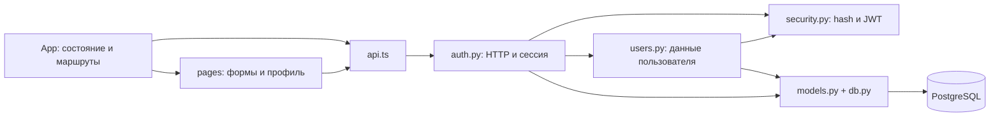

# Архитектура текущего прототипа

React → Nginx/Vite proxy → FastAPI → PostgreSQL. Регистрация, вход, выход, профиль
и API поиска пользователей реализованы. Работающая переписка и WebSocket в текущий объём не входят.

## Backend

- `main.py` создаёт FastAPI, подключает router, CORS, обработку ошибок и health/ready.
- `auth.py` содержит HTTP-маршруты auth/users и функции проверки текущей сессии.
- `users.py` содержит схемы запросов/ответов, поиск и создание пользователя. Отдельных слоёв
  repository/service нет: связанные операции находятся рядом.
- `security.py` хеширует пароли и создаёт/проверяет JWT; параметры безопасности сохранены.
- `models.py` описывает User/AuthSession и неиспользуемый задел таблиц переписки.
- `db.py` открывает SQLAlchemy-сессии; `config.py` читает настройки; `seed.py` создаёт demo-аккаунты явно.

Схема БД меняется миграциями Alembic. HTTP API, коды ошибок, таблицы и ограничения при
упрощении структуры не менялись. Контракт: [auth-contract.md](auth-contract.md).

## Frontend

- `App.tsx` хранит user/loading/error, выполняет login/logout и восстановление сессии,
  показывает общую оболочку и выбирает маршруты.
- `pages.tsx` содержит AuthPage, ProfilePage и существующие оболочки диалогов/чата.
  Страницы получают данные и обработчик входа через обычные props.
- `api.ts` делает HTTP-запросы, добавляет Bearer и обрабатывает сетевые/HTTP-ошибки.
- `components.tsx` содержит Button/Input/Card; `styles.css` сохраняет исходное оформление.

Отдельного React Context и пользовательского useAuth-хука больше нет. Состояние видно в
одном компоненте; функция protect в App показывает загрузку/ошибку либо переводит гостя на вход.

## Экраны и состояния

`/` и `/login` — вход; `/register` — регистрация; `/profile` — защищённый профиль.
`/dialogs` и `/chat/:chatId` — защищённые оболочки без работающей отправки. Неизвестный путь — 404.
Регистрация предлагает перейти ко входу. Refresh проверяет `/users/me`; logout отзывает серверную
сессию. Ошибка сети профиля показывает повтор; 401 очищает локальную сессию без цикла запросов.

Nginx раздаёт frontend и передаёт `/api/*` в backend без префикса `/api`.
При разработке на хосте это делает Vite proxy. PostgreSQL хранит данные в именованном volume.
Внешний production-сервер и автоматический CD не настроены.

Таблицы chats/chat_members/messages сохранены для совместимости миграций, но пустые Python-пакеты
chats/messages/search удалены. Наличие этих таблиц не означает готовый сценарий переписки.

[Карта переноса файлов и порядок чтения](structure.md). Изображения экранов в `docs/mockups`
и внешний вид приложения при изменении структуры не перерабатывались.
