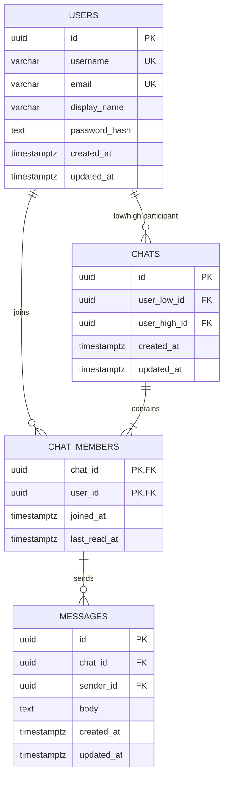

# Данные и ранжированный поиск

## Схема данных и сохранённый задел



UUID генерирует приложение. Даты хранятся с часовым поясом, клиент показывает местное время.
Username и email приводятся к нижнему регистру API регистрации до записи.
Миграция 0002 дополнительно обеспечивает уникальность lower(username) и lower(email),
а также создаёт auth_sessions (id, user_id, expires_at) для отзыва токенов.
Таблицы переписки ниже сохранены в схеме, но рабочий сценарий сообщений отсутствует.
Пароль в открытом виде никогда не хранится.

Для личных диалогов UUID участников сортируются: low < high, пара уникальна.
Это запрещает чат с собой и дубли A–B / B–A даже при конкурентных запросах.
API S3 должно создавать чат и ровно двух членов одной транзакцией: сама схема не проверяет
соответствие строк chat_members паре chats. Составной FK сообщения запрещает отправителя,
не включённого в чат. Изменять `updated_at` должен ORM; сырой SQL обязан выставлять дату сам.
История использует индекс `(chat_id, created_at, id)` и cursor по `(created_at, id)`,
а не OFFSET по всей истории. Удаление связанных сущностей пока ограничено FK, каскадного удаления нет.

## Отложенное проектирование BM25 (не реализовано)

Выбран собственный модуль BM25 с инвертированным индексом, не простой LIKE и не вызов готового ранжировщика.
Это историческое проектирование по прежнему плану. По пересмотренному объёму реализация BM25 исключена. Наличие описания не означает готовый поиск.

Вход: user_id из серверной сессии, строка запроса длиной 1–200 символов,
опциональный chat_id, limit 1–50. Выход: message_id, chat_id, фрагмент текста, score;
порядок по score DESC, created_at DESC, id для стабильных совпадений.

Токенизация: Unicode lower/casefold, слова и цифры, одинаковая для запроса и документов.
На первом этапе без стемминга: «привет» и «приветы» различаются. Повторные термы запроса учитываются один раз.
Параметры k1=1.5, b=0.75.

```
idf(t) = ln(1 + (N - df(t) + 0.5) / (df(t) + 0.5))
score(d,q) = sum(idf(t) * tf(t,d)*(k1+1) /
                 (tf(t,d) + k1*(1-b+b*len(d)/avgdl)))
```

N, df и avgdl считаются только по доступному пользователю корпусу: чужие сообщения
не должны влиять даже на score. При N=0, пустой токенизации или отсутствии совпадений — пустая выдача.
Перед ранжированием сервер получает доступные chat_id; недоступный явно указанный чат даёт 403.
После получения кандидатов доступ проверяется повторно. Текст и индекс должны обновляться
в одной согласованной версии при редактировании сообщения; устаревшие записи не возвращаются.

Построение индекса: O(T) по общему числу токенов, память O(T) в худшем случае.
Запрос: O(sum(df(t)) + C log k) для postings и top-k heap, где C — число кандидатов;
для первого учебного прототипа допустима сортировка O(C log C), это явно замеряется.
В малом MVP разрешено строить индекс по доступному корпусу за O(T) на запрос;
на защите нельзя выдавать это за стоимость только обхода postings.

Качество: фиксированный набор минимум из 30 русских/английских сообщений в нескольких чатах,
10 размеченных запросов, Precision@5 >= 0.8, чужих сообщений в выдаче ровно 0.
Отдельные тесты: редкое слово выше частого; насыщение повторов; нормализация длины;
ничьи; пустой запрос; изменение текста; смена доступа. Сравнить с LIKE на 1k/10k сообщений
по релевантности и p50/p95 времени. Результаты пока не измерены.
